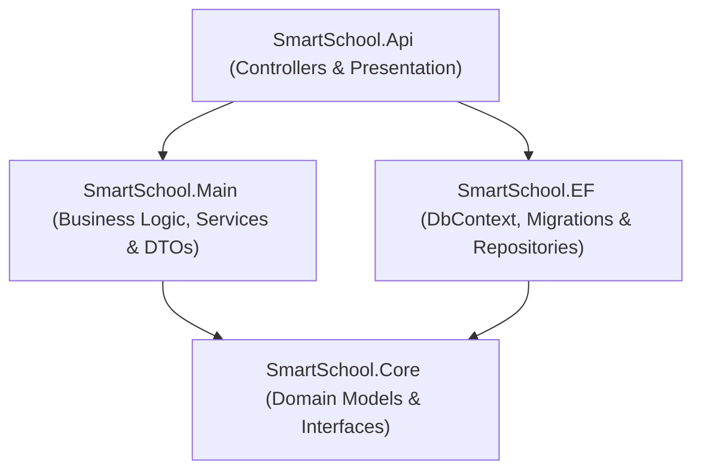

<div align="center">

# ⚙️ خادم نظام المدرسة الذكية (Smart School Backend API)
### واجهات برمجة التطبيقات وقواعد البيانات للمنظومة التعليمية

[](https://dotnet.microsoft.com/)
[](https://docs.microsoft.com/en-us/dotnet/csharp/)
[](https://learn.microsoft.com/en-us/ef/core/)
[](https://www.microsoft.com/sql-server)
[](https://jwt.io/)

<p align="center">
  الخادم الخلفي المتكامل لمنصة المدرسة الذكية المبني بأحدث معايير هندسة البرمجيات (.NET 9 Web API) مع تطبيق نمطي Repository Pattern و Unit of Work، مع نظام مصادقة متقدم (ASP.NET Core Identity + JWT).
</p>

[المعمارية البرمجية](#-المعمارية-البرمجية) • [نقاط النهاية Endpoints](#-نقاط-النهاية-api-endpoints) • [التثبيت والتشغيل](#-التثبيت-والتشغيل) • [تغذية البيانات Seeding](#-التغذية-التلقائية-للبيانات-data-seeding)

---

</div>

## 📑 فهرس المحتويات
1. [نظرة عامة](#-نظرة-عامة)
2. [المعمارية البرمجية والهيكلة](#-المعمارية-البرمجية-والهيكلة)
3. [مخطط العلاقات وقاعدة البيانات](#-مخطط-العلاقات-وقاعدة-البيانات-erd)
4. [نقاط النهاية (API Endpoints)](#-نقاط-النهاية-api-endpoints)
5. [الأمان والمصادقة (JWT + Identity)](#-الأمان-والمصادقة)
6. [التغذية التلقائية للبيانات (Data Seeding)](#-التغذية-التلقائية-للبيانات-data-seeding)
7. [خطوات التثبيت والتشغيل](#-خطوات-التثبيت-والتشغيل)

---

## 🌟 نظرة عامة
يوفر مشروع **`SmartSchool Backend API`** البنية التحتية الخلفية لمنظومة المدرسة الذكية، حيث يتكفل بمعالجة كافة العمليات الحسابية والمنطقية، وحماية البيانات، وإدارة الصلاحيات لمختلف فئات المستخدمين (`الأدمن`, `المعلمين`, `أولياء الأمور`, و`الطلاب`)، بالإضافة إلى الجدولة والحضور والغياب والاختبارات.

---

## 🏛️ المعمارية البرمجية والهيكلة

تم بناء المشروع باتباع أفضل الممارسات في **Onion Architecture / Clean Architecture** مع فصل المهام إلى مشاريع منفصلة:



### تقسيم المشاريع في الـ Solution:
* **`SmartSchool.Core`**: يحتوي على الكيانات الأساسية (`Domain Models`)، واجهات المستودعات (`Repository Interfaces`)، وواجهة `IUnitOfWork`.
* **`SmartSchool.EF`**: إعدادات قاعدة البيانات `ApplicationDbContext`، مستودعات البيانات الملموسة (`Repositories`)، وملفات الـ `Migrations`.
* **`SmartSchool.Main`**: الخدمات المنطقية (`Services`)، كائنات نقل البيانات (`DTOs`)، وخدمات المصادقة والتشفير `AuthService`.
* **`SmartSchool.Api`**: الـ `Controllers`، حقن التبعيات (`Dependency Injection`)، ملف `DataSeeder.cs`، وإعدادات الـ `JWT / Swagger`.

---

## 📊 مخطط العلاقات وقاعدة البيانات (ERD)

| مخطط الكيانات والعلاقات |
|:---:|
|  |

> [!TIP]
> يشتمل المخطط على جداول الهوية للمستخدمين `Users`، المعلمين `Teachers`، الطلاب `Students`، أولياء الأمور `Guardians`، الصفوف `Grades`، الشعب `Groups`، المواد `Subjects` و `SubjectDetails`، الاختبارات `Exams` و `Resultes`، الواجبات `Assignments` و `SubmittedAssignments`، جدول الحصص `TimeTables`، وسجلات الحضور `StudentAttendances`.

---

## 🔌 نقاط النهاية (API Endpoints)

### 1. المصادقة والجلسات (`AuthController`)
* `POST /api/Auth/login`: تسجيل الدخول وإصدار `AccessToken` و `RefreshToken`.
* `POST /api/Auth/refresh`: تجديد التوكن تلقائياً.
* `POST /api/Auth/logout`: إنهاء الجلسة وإبطال التوكن.

### 2. شؤون الطلاب والمعلمين (`Users & Academics`)
* `/api/Students/*`: جلب، إضافة، تعديل، وحذف بيانات الطلاب.
* `/api/Teachers/*`: إدارة ملفات المعلمين وتخصصاتهم.
* `/api/Guardians/*`: إدارة أولياء الأمور وصلات القرابة.
* `/api/Specialties/*`: إدارة التخصصات الأكاديمية والمؤهلات.

### 3. الصفوف والمجموعات (`Grades & Groups`)
* `/api/Grades/*`: إدارة الصفوف الـ 12 والطاقة الاستيعابية.
* `/api/Groups/*`: إدارة الشعب والمجموعات للسنوات الدراسية.

### 4. المناهج وتوزيع الحصص (`Curriculum`)
* `/api/Subjects/*`: دليل المواد الدراسية.
* `/api/SubjectDetails/*`: ربط المواد بالصفوف وساعات الحصص.
* `/api/TeachingSubjects/*`: تكليف المعلمين بالمواد.

### 5. التقييم والواجبات (`Assessments`)
* `/api/ExamType/*`: أنواع الامتحانات (شهري، نصفي، نهائي).
* `/api/Exam/*`: جدول ومواعيد الامتحانات.
* `/api/Resulte/*`: رصد درجات الطلاب والتقديرات.
* `/api/Assignments/*`: إدارة الواجبات المدرسية ومواعيد التسليم.
* `/api/SubmittedAssignments/*`: استلام وتصحيح واجبات الطلاب.

### 6. جدول الحصص والحضور (`Timetable & Attendance`)
* `/api/TimeTables/*`: إدارة وتوزيع الحصص الأسبوعية مع فحص التعارض.
* `/api/StudentAttendances/*`: رصد الحضور والغياب اليومي للطلاب.

---

## 🔒 الأمان والمصادقة
* الاعتماد على نظام **`ASP.NET Core Identity`** لإدارة كلمات المرور وتشفيرها بالـ `PBKDF2`.
* تشفير التوكن عبر **`JWT Bearer Token`** مع ضبط التحقق من التوقيع والـ Issuer والـ Audience وتاريخ الانتهاء.
* حماية جميع الـ Endpoints برمجياً عبر `[Authorize]` مع صلاحية الدخول للأدوار المحددة.

---

## 🌱 التغذية التلقائية للبيانات (Data Seeding)

يتضمن ملف [`DataSeeder.cs`](SmartSchool.Api/DataSeeder.cs) تغذية تلقائية شاملة تبدأ فور تشغيل الخادم وتغطي:
* إنشاء حساب الأدمن الافتراضي:
  * **البريد الإلكتروني**: `admin@school.com`
  * **كلمة المرور**: `Admin@1234`
* 12 صفاً دراسياً من الأول الابتدائي حتى الثالث الثانوي.
* التخصصات الأكاديمية والمؤهلات المتطابقة.
* 5 معلمين، 5 أولياء أمور، و 5 طلاب بحساباتهم الكاملة.
* مواد دراسية وتفاصيل المناهج وجداول الحصص.
* أنواع اختبارات، جداول امتحانات، نتائج وواجبات وسجلات حضور وغياب.

---

## ⚙️ خطوات التثبيت والتشغيل

### المتطلبات المسبقة:
* **.NET 9.0 SDK** مثبت على الجهاز.
* خادم **Microsoft SQL Server** (أو LocalDB).
* أدوات الـ EF Core CLI (`dotnet-ef`).

### خطوات البدء:

1. **استنساخ المستودع (`Clone`)**:
   ```bash
   git clone https://github.com/Musab-program/Smart-School---Admin.git
   cd Smart-School---Admin
   ```

2. **ضبط الاتصال بقاعدة البيانات (`Connection String`)**:
   في ملف `SmartSchool.Api/appsettings.json`، تأكد من صحة مسار الاتصال:
   ```json
   "ConnectionStrings": {
     "DefaultConnection": "Server=.;Database=SmartSchool;Trusted_Connection=True;TrustServerCertificate=True"
   }
   ```

3. **تحديث قاعدة البيانات (`Database Migrations`)**:
   ```bash
   dotnet ef database update --project SmartSchool.EF --startup-project SmartSchool.Api
   ```

4. **بناء وتشغيل الخادم (`Run`)**:
   ```bash
   dotnet run --project SmartSchool.Api
   ```

5. **استعراض الـ API والتوثيق (`Swagger`)**:
   افتح المتصفح وتوجه إلى الرابط التفاعلي:
   ```text
   https://localhost:7191/swagger
   ```

---

<div align="center">
  <sub>منظومة المدرسة الذكية - الخادم الخلفي &copy; 2026</sub>
</div>
